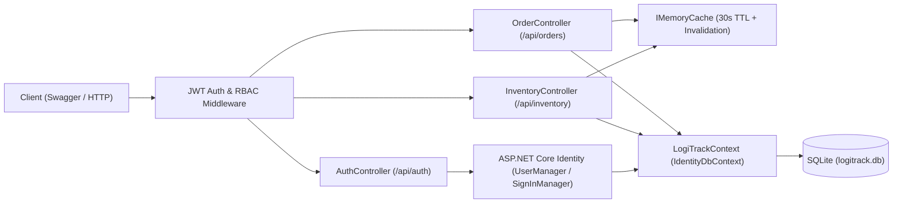
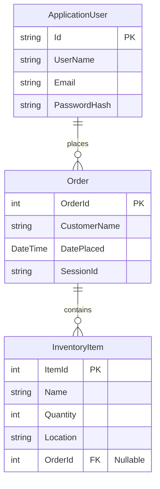

# LogiTrack Order Management System — System Specification

## 1. System Overview
**LogiTrack** is a secure, high-performance RESTful Order Management System API built with **ASP.NET Core Web API** and **Entity Framework Core** backed by **SQLite**. It manages warehouse inventory items and customer fulfillment orders across multiple locations, providing JWT-based authentication, role-based access control (RBAC) via ASP.NET Core Identity, in-memory response caching with automatic invalidation, and persistent state management.

---

## 2. Technology Stack & Tooling
| Layer | Technology | Notes |
| :--- | :--- | :--- |
| **Runtime & Framework** | .NET 8.0 (`net8.0`) ASP.NET Core Web API | LTS runtime (`8.0.417`), native `Swashbuckle.AspNetCore` support |
| **ORM & Persistence** | Entity Framework Core (`8.0.*`) + SQLite | `Microsoft.EntityFrameworkCore.Sqlite`, `Microsoft.EntityFrameworkCore.Tools` |
| **Authentication & RBAC** | ASP.NET Core Identity + JWT Bearer | `Microsoft.AspNetCore.Identity.EntityFrameworkCore`, `Microsoft.AspNetCore.Authentication.JwtBearer` |
| **Caching** | `Microsoft.Extensions.Caching.Memory` | `IMemoryCache` with 30-second TTL, rehydration, and write-through invalidation |
| **API Documentation** | OpenAPI / Swagger UI | Configured with JWT Bearer security scheme for interactive testing |

---

## 3. Domain Model & Database Schema

### 3.1 `InventoryItem` (`Models/InventoryItem.cs`)
- **Properties:**
  - `ItemId` (`int`, `[Key]`) — Primary key.
  - `Name` (`string`, `[Required]`, `[MaxLength(150)]`) — Item name.
  - `Quantity` (`int`, `[Range(0, int.MaxValue)]`) — Available or allocated quantity.
  - `Location` (`string`, `[Required]`, `[MaxLength(100)]`) — Warehouse/fulfillment location (e.g., `"Warehouse A"`).
  - `OrderId` (`int?`) — Optional foreign key referencing `Order.OrderId` (supports standalone stock items as well as order-allocated items).
  - `Order` (`Order?`, `[JsonIgnore]`) — Navigation property to avoid circular serialization.
- **Methods:**
  - `DisplayInfo()`: Writes `"Item: {Name} | Quantity: {Quantity} | Location: {Location}"` to console.

### 3.2 `Order` (`Models/Order.cs`)
- **Properties:**
  - `OrderId` (`int`, `[Key]`) — Primary key.
  - `CustomerName` (`string`, `[Required]`, `[MaxLength(150)]`) — Customer identifier/name.
  - `DatePlaced` (`DateTime`) — Timestamp when order was placed (defaults to `DateTime.UtcNow`).
  - `SessionId` (`string?`, `[MaxLength(100)]`) — Optional session/user correlation token for state persistence (Part 5).
  - `Items` (`List<InventoryItem>`) — Collection navigation property (`1:N` relationship).
- **Methods:**
  - `AddItem(InventoryItem item)`: Null-checks and adds or merges item into `Items`.
  - `RemoveItem(int itemId)`: Removes matching item by `ItemId`, returning `bool`.
  - `GetOrderSummary()`: Returns `"Order #{OrderId} for {CustomerName} | Items: {Items.Count} | Placed: {DatePlaced:M/d/yyyy}"`.

### 3.3 `ApplicationUser` (`Models/ApplicationUser.cs`)
- Inherits from `IdentityUser` to integrate with `IdentityDbContext<ApplicationUser>`.

### 3.4 `LogiTrackContext` (`LogiTrackContext.cs`)
- Starts as `DbContext` in Activities 1–2 and upgrades to `IdentityDbContext<ApplicationUser>` in Activity 3.
- Exposes `DbSet<InventoryItem> InventoryItems` and `DbSet<Order> Orders`.
- Configures `Order` $\leftrightarrow$ `InventoryItem` one-to-many relationship and indexes on frequently queried columns (`OrderId`, `Name`, `DatePlaced`).

---

## 4. API Specification

| Method | Route | Auth Policy | Description | Cache Behavior |
| :--- | :--- | :--- | :--- | :--- |
| `POST` | `/api/auth/register` | `[AllowAnonymous]` | Register a new user (with optional role assignment for testing/seeding) | N/A |
| `POST` | `/api/auth/login` | `[AllowAnonymous]` | Authenticate user and return signed JWT token + expiration | N/A |
| `GET` | `/api/inventory` | `[Authorize]` | Retrieve all inventory items | Cached (`30s` absolute TTL) |
| `POST` | `/api/inventory` | `[Authorize(Roles = "Manager")]` | Create a new inventory item | Invalidates inventory cache |
| `DELETE` | `/api/inventory/{id}` | `[Authorize(Roles = "Manager")]` | Delete an inventory item by ID | Invalidates inventory cache |
| `GET` | `/api/orders` | `[Authorize]` | Retrieve all orders (with eager-loaded `Items` & `.AsNoTracking()`) | Cached / Optimized |
| `GET` | `/api/orders/{id}` | `[Authorize]` | Retrieve single order with `Items` and summary | `.AsNoTracking()` + `.Include()` |
| `POST` | `/api/orders` | `[Authorize]` | Create a new order with multiple inventory items | Persists & updates state cache |
| `DELETE` | `/api/orders/{id}` | `[Authorize(Roles = "Manager")]` | Delete an order by ID | Invalidates order cache |

---

## 5. Security, Performance & State Management Architecture
1. **Authentication & Authorization (Activity 3):**
   - Stateless JWT Bearer authentication signed with HMAC-SHA256 (`SymmetricSecurityKey`).
   - Role seeding on startup (`Manager` and `User` roles).
   - Input validation via Data Annotations (`[Required]`, `[EmailAddress]`, `[Range]`, `[ApiController]` automatic `400 BadRequest` model validation).
2. **Performance & Caching (Activity 4):**
   - `IMemoryCache` stores the inventory list under `"InventoryList_CacheKey"` with a 30-second TTL (`AbsoluteExpirationRelativeToNow = TimeSpan.FromSeconds(30)`).
   - Write operations (`POST`, `DELETE`) explicitly evict `"InventoryList_CacheKey"` to prevent stale reads.
   - Read queries use `.AsNoTracking()` and `.Include(o => o.Items)` to eliminate EF Core change-tracker overhead and $N+1$ query bottlenecks.
   - Execution latency is measured via `Stopwatch` and logged / exposed in `X-Response-Time-Ms` and `X-Cache-Status` headers.
3. **State Persistence across Sessions (Activity 5):**
   - Hybrid **Database + Cache Rehydration** strategy: SQLite persists all committed orders, user accounts, and inventory across process restarts, while session/draft state and active order lookups are tracked with `SessionId` / user claim correlation and rehydrated into `IMemoryCache` on demand.
